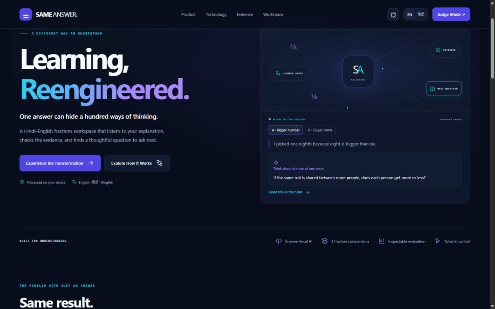

# Same Answer

A Hindi–English fractions tutor that asks about the reasoning behind an answer. Built for INNOVEX 2026, PS 03 Intelligent Education.

Two learners select 1/8 over 1/6. One says eight is bigger than six. The other imagined an eighth of a larger roti. Same Answer suggests different follow-up questions, gives the tutor control over the teaching card, and offers a fresh fraction pair for independent practice.

## Run locally

Requires Node.js 22 or later. No npm installation or API credentials are needed.

```sh
npm start
```

Open http://127.0.0.1:4173. Keep the server running while using the app. Serve the `dist` directory over HTTP, since the app loads local JSON and JavaScript modules. A refresh or Reset clears responses. On Windows you can also double-click `START.cmd`.

## Try the complete experience

The redesigned home page opens first. **Experience the Transformation** opens the existing tutor. **Judge Mode** offers seven manually paced steps with a suggested total of three minutes. Finishing or exiting restores the prior learner state, question, language and view. The live workflow follows actual session stages, and the home preview runs the same checked routing as the tutor.

1. Click the example “Eight is bigger than six.” The next question explores the size of one piece.
2. Click “My roti was much bigger.” The next question clarifies the original whole.
3. Click “What if I’m unsure?” and add a detail or choose a teaching card with a tutor.
4. Try a fresh pair and submit an explanation. The first comparison answer is recorded before the bars and exact answer appear.
5. Open Compare methods to inspect the learned model and keyword route on the same explanation.
6. Open Evidence to see all evaluation cases, errors, denominators, and the model fingerprint.

Free typing accepts English, Hindi, Romanized Hindi, and mixtures, up to 300 characters. The interface has English and Hindi modes. Switching language or theme preserves the current session. Choosing an authored example opens sample practice and offers **Return to my session**. The first sample temporarily saves the previous session in memory; subsequent samples retain that return point. Switching the practice question starts that question again. Reset clears active practice and the sample return point; inside Judge Mode, it resets only the demonstration. Refresh clears all in-memory work.

The sidebar collapses, architecture tabs support arrow keys, and major screens have dark and light themes. Theme preference is the only value saved locally, when browser storage is available. Fonts prefer installed Space Grotesk, Inter and JetBrains Mono, with system fallbacks. No remote font request is made.



## How it works

The static app runs in the browser. Integer cross-multiplication checks numeric comparisons. A character 2–4 gram multinomial Naive Bayes classifier proposes a teaching category. Its weights and original development-selected thresholds remain frozen. Shared evidence checks then examine topic cues, explicit uncertainty, negated claims, mixed number roles, and support for the proposed category. Clear number-role evidence can correct a conflicting raw proposal. Conflicting numerical answers and apparently consistent reasoning lead to another check. A tutor may override the teaching route.

Both prediction methods use the same teaching cards and the same evidence checks. The baseline counts authored English/Hindi/Hinglish keywords. Comparison views show the raw proposals and the final checked routes. This is hybrid model-and-rule routing. Model scores are internal signals. The app displays a suggested route and never a percentage of a learner’s understanding.

The three practice questions cover unit fractions, unequal denominators/numerators, and equivalent fractions. Each has a separate fresh-pair question. A larger physical portion can come from a larger whole, while the abstract number 1/8 remains smaller than 1/6.

## Reproduce training and evaluation

Python 3.10+ is needed only to retrain. It uses the standard library.

```sh
python tools/train.py
npm run evaluate
npm test
```

Training writes `dist/model.json` and a Python raw-classifier reference fixture. Evaluation runs browser-compatible JS inference and evidence checks, and writes `dist/evaluation.json`. Eleven automated test groups check raw Python/JavaScript agreement, all five known failures, the frozen challenge set, fallback safeguards, malformed assets, release hashes, and 24,336 fraction pairs using exact integer reference arithmetic.

The original 88 explanations are AI-assisted authored examples, rather than pupil observations. Family IDs keep translations and close paraphrases together. There are 48 training, 16 development (including four uncertain), and 24 original test examples. Those 24 examples are now a known regression set because their failures informed the evidence checks. The original report is preserved in `data/baseline-evaluation.json`. Model weights and thresholds were not retuned.

| Original 24 cases | Original raw model | Model + evidence checks | Keywords + evidence checks |
| --- | --- | --- | --- |
| Correct categories on clear explanations | 14 / 16 | 15 / 16 | 9 / 16 |
| Correct deferrals on uncertain explanations | 4 / 8 | 8 / 8 | 8 / 8 |
| Confident wrong categories | 5 / 24 | 0 / 24 | 0 / 24 |
| Clear cases deferred | 1 / 16 | 1 / 16 | 7 / 16 |

A separate 32-case challenge set was authored and frozen before implementing the safeguards. It was excluded from training and threshold selection. The routing policy was frozen before the first challenge evaluation, and the remaining clear-case deferral was retained. The same author prepared the cases and implementation, so independent validation remains necessary.

| New 32 authored challenge cases | Model + evidence checks | Keywords + evidence checks |
| --- | --- | --- |
| Correct categories on clear explanations | 15 / 16 | 12 / 16 |
| Correct deferrals on uncertain explanations | 16 / 16 | 16 / 16 |
| Confident wrong categories | 0 / 32 | 0 / 32 |
| Clear cases deferred | 1 / 16 | 4 / 16 |

The Evidence screen distinguishes the regression and challenge sets and exposes raw proposals alongside checked routes. These are small, same-author synthetic sets. Zero observed confident errors on these sets cannot establish real-world reliability. Pedagogical quality, classroom impact, and generalization require independent review and representative data. See [ERROR-FIXES.md](ERROR-FIXES.md) for each original failure and its safeguard.

Human bilingual peer review, educator review, and learner studies are pending. Hints carry no claim of teacher approval. The fresh-pair result checks the selected numeric comparison. A tutor should review the accompanying explanation separately. A successful session gives one practice observation.

## Privacy and failure recovery

Learner text is processed in memory. The app has no accounts, analytics, persisted learner responses, external fonts, or remote inference. Theme preference can persist locally; sample and judge return points exist only in memory. Its initial requests load the local app, model, content, and evaluation assets. A host can see ordinary request metadata. Reset clears active practice, subject to the demonstration behavior above; refresh clears all session memory. User text is inserted with text-safe rendering, and a Content Security Policy restricts resources to the same origin.

If the model is unavailable or incompatible, a labeled keyword fallback keeps practice usable. If the question bank cannot load, the app offers reload. A missing or incompatible report leaves the lesson usable and shows an evidence availability message. The report is shown only when its model hash matches the loaded model.

A small text model can still misunderstand unknown concepts and wording. The evidence checks cover explicitly authored cues and can also defer useful explanations. Their negation detection is conservative and does not determine the scope of arbitrary sentences. Use clarification and tutor override. Limits on fresh-pair attempts are session behavior, suitable for informal practice. The source and client state are inspectable, so results should be treated as practice feedback.

## Project layout

```text
dist/                  Deployable application, model, content and evidence
data/examples.json     Authored dataset with family-level splits
data/challenge.json    New authored cases frozen before the routing fixes
data/baseline-evaluation.json  Preserved original test results
data/python-predictions.json  Export consistency fixture
tools/train.py         Dependency-free training and threshold selection
tools/evaluate.mjs     Reproducible held-out comparison
tools/serve.mjs        Local static server
tests/core.test.mjs    Arithmetic, inference and release-integrity checks
tests/experience.test.mjs  Presentation, demo recovery and failure-state checks
dist/experience.js     Bilingual landing, architecture and tour presentation
SUBMISSION.md          Project description and judge walkthrough
QA.md                  Automated checks and browser verification record
ERROR-FIXES.md         Five failures, fixes, and current results
```

## Credits and authorship

Created with AI assistance in the BUILDER_BUILD workspace. The app, examples, hints, classifier, and keyword rules were authored for this prototype. Runtime uses standard browser APIs. Training uses Python’s standard library. Tests and local serving use Node.js built-in modules. Fonts use installed local families and system fallbacks. No pretrained third-party model or collected learner dataset is bundled.

The broader project rationale was informed by research on independent learning after assisted practice. Citation is for context, with no claim that this prototype reproduces the study’s intervention or outcomes.

- Bastani and colleagues, *Generative AI without guardrails can harm learning*, PNAS 2025. https://pmc.ncbi.nlm.nih.gov/articles/PMC12232635/
- MDN, text-safe rendering. https://developer.mozilla.org/en-US/docs/Web/API/Node/textContent
- GitHub, publishing Pages. https://docs.github.com/en/pages/getting-started-with-github-pages/creating-a-github-pages-site

## Next validation step

Have bilingual educators independently label new learner explanations and review every hint. Compare retrieval on those new families, then study delayed unaided transfer with equal teaching time. Any real learner study needs appropriate permissions and a separate data-handling plan.
